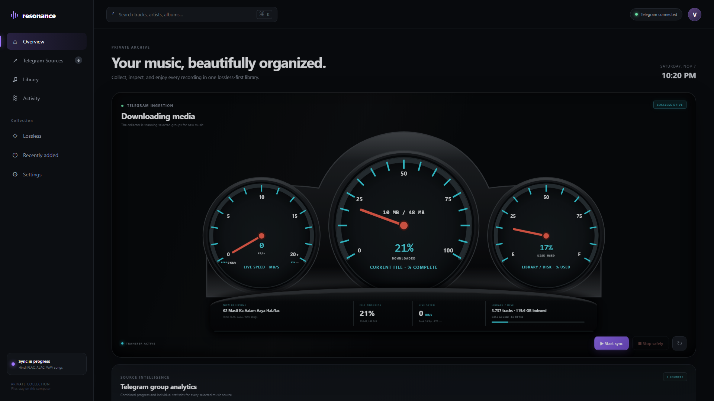

# Telegram Lossless Music Library

**Lossless Drive** turns audio shared in Telegram groups you are authorized to access into a searchable, organized, lossless-first music library.

[](LICENSE)


It downloads audio and ZIP attachments, safely extracts archives, reads embedded tags, removes exact duplicates, arranges tracks by artist and album, and provides a live operations dashboard and browser-based library.



## Features

- Phone login with Telegram verification code and optional 2FA
- Group and channel discovery with per-source selection
- Restartable history sync with safe start and stop controls
- Live speed, file progress, remaining work, ETA, and per-group analytics
- MP3, FLAC, WAV, ALAC/M4A, AAC, AIFF, APE, DSF, OGG, Opus, and WMA discovery
- Protected ZIP extraction with file-count and expanded-size limits
- Embedded metadata, format, bitrate, sample-rate, duration, and lossless analysis
- SHA-256 de-duplication even when filenames differ
- Artist/album organization with searchable tracks and album views
- Browser playback, including local preview conversion for unsupported codecs
- Local-first operation: credentials, session, database, and media stay on your computer

## How it works

```text
Authorized Telegram groups
           |
    Telethon user session
           |
  Download + safe extraction
           |
 Metadata + SHA-256 de-duplication
           |
    +------+----------------+
    |                       |
Artist/Album files     SQLite catalog
                            |
                   FastAPI dashboard/API
```

The collector uses a Telegram **user session** because the Bot API cannot backfill arbitrary group history. The session file is an account credential: keep it private, never commit it, and consider using a dedicated Telegram account.

## Requirements

- Python 3.11 or newer
- A Telegram account with legitimate access to the selected groups
- Telegram API ID and API hash from [my.telegram.org](https://my.telegram.org)
- Enough local storage for downloaded and extracted media

## Quick start

```powershell
git clone https://github.com/VishwnathV/telegram-lossless-music-library.git
cd telegram-lossless-music-library
py -3.11 -m venv .venv
.\.venv\Scripts\Activate.ps1
python -m pip install -e ".[dev]"
music-library init
music-library serve --host 127.0.0.1 --port 8000
```

Open `http://127.0.0.1:8000`, then:

1. Open **Telegram Sources**.
2. Enter and save your Telegram API ID and API hash.
3. Sign in with your phone number, Telegram code, and 2FA password when requested.
4. Refresh the source list, select authorized groups, and save.
5. Return to **Overview** and choose **Start sync**.

On Windows, after installation you can launch the app with **`Start Lossless Drive.cmd`**.

To catalog an existing local collection:

```powershell
music-library scan D:\Music
```

## Configuration

Dashboard setup is recommended. Environment variables are also supported; copy `.env.example` to `.env` and adjust these values:

| Variable | Purpose | Default |
|---|---|---|
| `TG_API_ID`, `TG_API_HASH` | Telegram application credentials | unset |
| `TG_SESSION_PATH` | Local Telethon session location | `./data/telegram` |
| `TG_SOURCES` | Comma-separated source IDs, names, or links | empty |
| `DATA_DIR`, `INCOMING_DIR`, `LIBRARY_DIR` | Runtime and media locations | local folders |
| `DATABASE_PATH` | SQLite catalog location | `./data/library.sqlite3` |
| `PLAYBACK_CACHE_DIR` | Browser-compatible preview cache | `./data/playback-cache` |
| `MAX_DOWNLOAD_BYTES` | Maximum single download size | 10 GiB |
| `MAX_ARCHIVE_FILES` | Maximum files extracted from one archive | 5,000 |
| `MAX_ARCHIVE_BYTES` | Maximum expanded archive size | 20 GiB |
| `KEEP_INCOMING` | Preserve staging downloads after import | `false` |

All runtime data, sessions, credentials, downloaded media, databases, and logs are excluded by `.gitignore`.

## Library organization

Files with useful tags are stored as:

```text
Library/
  Artist/
    2024 - Album/
      01 - Track Title.flac
```

When tags are absent, Lossless Drive uses the filename and places the item under `Unknown Artist/Unknown Album`. Original lossless files are preserved; ingestion does not transcode them.

## Security and privacy

The dashboard binds to `127.0.0.1` by default and has no web-user authentication. Do not expose it directly to the internet. Add HTTPS, authentication, authorization, and per-user media permissions before a remote or multi-user deployment.

Never commit `.env`, Telegram `.session` files, the database, downloaded media, or logs. The included `.gitignore` excludes these paths, but review every commit before publishing.

## Open-source and legal disclaimer

This is an independent open-source project and is not affiliated with, endorsed by, or sponsored by Telegram. It does not bypass Telegram permissions, access controls, encryption, or DRM, and the repository includes no music or other third-party media.

Use it only with groups and media you are legally authorized to access, download, store, and process. You are responsible for complying with copyright law, privacy obligations, Telegram's terms, group rules, and applicable local laws. Do not use this software to infringe rights or redistribute content without permission. The software is provided **as is**, without warranty; see the [MIT License](LICENSE).

## Development

```powershell
python -m pytest
python -m ruff check .
```

Contributions are welcome. Please open an issue before a large change, keep credentials and media out of commits, add tests for behavior changes, and run the checks above before submitting a pull request.

## Roadmap

- Cover-art extraction and richer album presentation
- Optional MusicBrainz/AcoustID enrichment with explicit privacy controls
- Acoustic-fingerprint duplicate detection
- Playlists, favorites, and saved searches
- PostgreSQL and worker queues for very large libraries
- Optional official Telegram bot for searching and returning permitted library files

## License

Released under the [MIT License](LICENSE).
